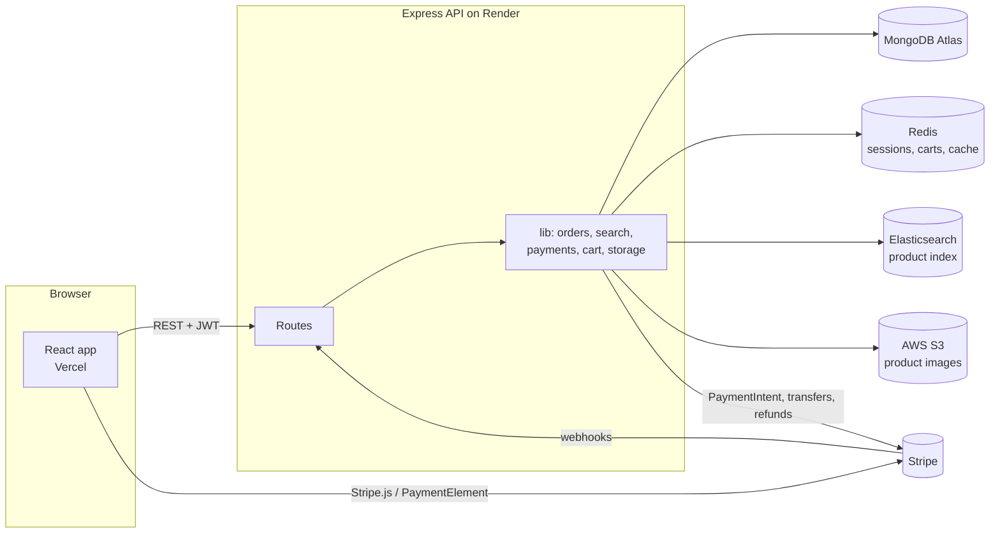
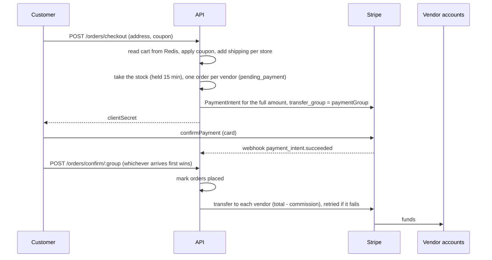
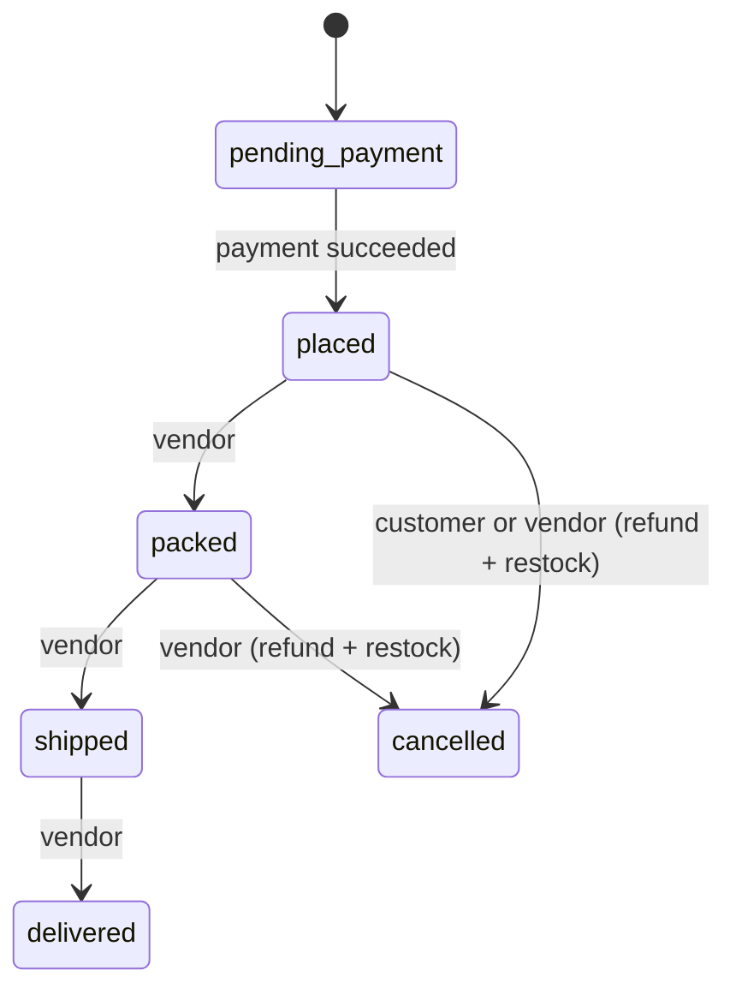
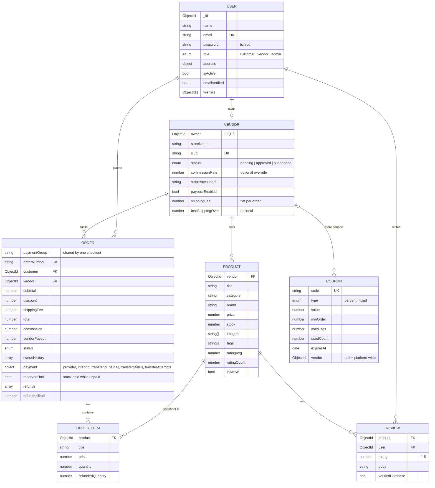

# Architecture

## Overview

- **MongoDB** is the source of truth for users, stores, products, orders, reviews and coupons.
- **Elasticsearch** holds a denormalised copy of each visible product (product data plus the store name). It is updated after every product write, review or store approval change. If ES is unreachable, writes still succeed and `POST /api/admin/search/reindex` rebuilds the index.
- **Redis** stores sessions (`session:<id>`), carts (`cart:<userId>`, a hash of productId to quantity), cached product pages (`product:<id>`, 5 minute TTL, cleared on update), recently viewed products (`recent:<userId>`, a capped list), one-time email tokens (`verify:<hash>`, `reset:<hash>`) and the background jobs lock (`lock:jobs`).
- **S3** stores product images. The API uploads them and keeps the URLs on the product.

## Roles

| Role | Can do |
| --- | --- |
| customer | browse, search, cart, checkout, cancel own placed orders, review products, download own invoices |
| vendor | create a store, connect Stripe, manage own products, coupons and orders, move orders through the lifecycle |
| admin | approve or suspend stores, set per-store commission, manage platform coupons, disable users, view analytics, rebuild the search index |

Admins are only created by the seed script or directly in the database. Signing up as an admin through the API is rejected.

## Checkout and payment split

This is Stripe's "separate charges and transfers" model. The customer pays once, the platform holds the money, and each vendor's transfer is linked to the original charge with `source_transaction`. `completePayment` claims each order with an atomic `pending_payment → placed` update, so the webhook and the confirm call can both run without paying a vendor twice.

Commission is worked out per order on the goods only: `commission = (subtotal − discount) × rate`, `vendorPayout = total − commission`. Shipping goes to the vendor in full, since they pay to ship it. The rate is the vendor's own `commissionRate` if an admin set one, otherwise `COMMISSION_RATE` (10%).

Each store sets a flat `shippingFee` per order and an optional `freeShippingOver` threshold. `GET /cart/quote` returns the per-store breakdown so the cart and checkout show the same numbers the order will have.

A coupon's discount is split across vendor orders in proportion to their subtotals (only the matching vendor for store coupons), so each vendor's payout reflects the discount on their own items.

## Order lifecycle

Orders can only move one step forward. Every change is recorded in `statusHistory` with a timestamp. A `pending_payment` order that isn't paid within 15 minutes is cancelled and its stock goes back.

## Payouts, refunds and background jobs

Every paid order has `payment.transferStatus`: `pending → paid`, or `failed` if Stripe refuses the transfer (for example the vendor's account isn't ready). Failed transfers are retried after 1, 5, 30, 120 and 360 minutes, and after that only an admin can retry from the Payouts page. Cancelled orders mark an unpaid payout `skipped`.

Vendors can refund single items (`POST /orders/:id/refund`). The refund is the items' price minus their share of the coupon discount. Shipping isn't refunded. If the payout already went out, the vendor's share (`amount × (1 − rate)`) is taken back with a Stripe transfer reversal, and the platform gives up its commission on the refunded part. Items that haven't shipped go back into stock. Cancelling an order later refunds only what's left.

`src/lib/jobs.js` runs every minute inside the API process: it expires stock holds and retries payouts that are due. A Redis `SET NX` lock with a 55 second TTL means only one instance does the work when several are running. For a single Render instance this avoids a separate worker. With more traffic it could move to a queue like BullMQ.

Emails (order placed, order shipped, store approved, verify email, reset password) go through Nodemailer when `SMTP_URL` is set and are logged otherwise. A failed email never fails the request that sent it.

## Database schema

Order items keep a copy of the title, image and price at the time of purchase, so invoices stay correct after a vendor edits or removes a product.

### Indexes

- `users.email` unique
- `vendors.owner`, `vendors.slug` unique
- `products.vendor`, `products.category`, plus a text index on title, description, brand and tags (used by the Mongo search fallback)
- `orders.paymentGroup`, `orders.customer`, `orders.vendor`, `orders.status`
- `orders (status, reservedUntil)` and `orders (payment.transferStatus, payment.nextTransferAt)` for the background jobs
- `reviews (product, user)` unique
- `coupons.code` unique

## Design decisions

- **One order per vendor.** Each vendor packs and ships independently, so splitting at checkout keeps the lifecycle, payouts and invoices simple. The shared `paymentGroup` ties them back to one payment.
- **Stock is held at checkout for 15 minutes.** Taking it only at payment meant a customer could pay for something that sold out in the meantime and get an automatic refund. Holding it means checkout fails up front with a clear message instead. Abandoned checkouts give the stock back when the hold runs out, or straight away if the same customer checks out again. If a Stripe payment lands after the hold expired, the job finishes the order instead of cancelling it.
- **Search fallback matches partial words.** MongoDB's text index only matches whole words, so when it finds nothing the fallback retries with case-insensitive substring matching on title, brand, category and tags ("phone" finds "iPhone").
- **Fallbacks for every external service.** The mock Redis, Mongo search and mock payment provider mean the project runs and is fully testable on a laptop with no accounts. Production config uses the real services.
- **Sessions in Redis on top of JWT.** A plain JWT can't be revoked. Checking a Redis session on each request costs about a millisecond and makes logout and account disabling take effect at once.
