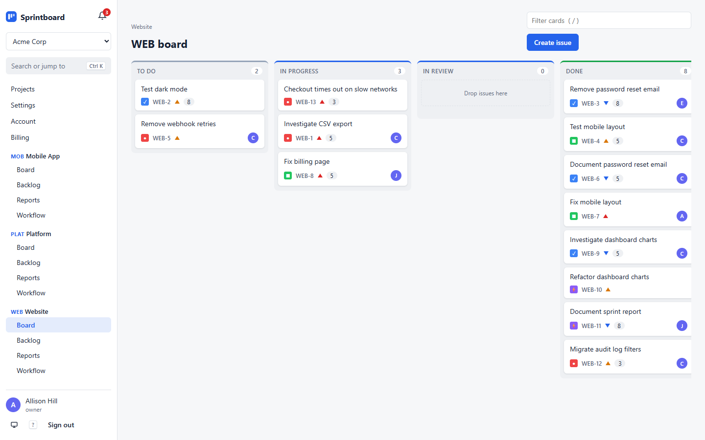
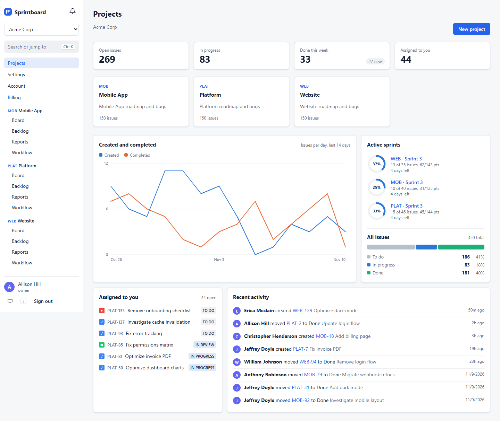

# Sprintboard

A multi-tenant project tracker in the style of Jira. Each company gets its own workspace with projects, a Kanban
board, sprints, custom workflows and a paid plan through Stripe.

Built for the Nexvia Technologies full-stack internship (FS-04), Oct-Nov 2026.

**Live demo:** https://sprintboard-web.onrender.com (press **Try the demo**) · **Walkthrough video:** [docs/WALKTHROUGH.md](docs/WALKTHROUGH.md)





There's a 2.5 minute video of the main flows, billing included, in [docs/WALKTHROUGH.md](docs/WALKTHROUGH.md).

## What it does

- Workspaces with owner, admin, member and viewer roles, invites and workspace switching
- Kanban board with drag and drop, a backlog and sprint planning
- Per-project workflows: your own statuses and which moves between them are allowed
- Comments with @mentions, attachments, and a history of every field change
- Webhooks signed with HMAC and retried with backoff, plus in-app and email notifications
- A workspace overview on the home page: open and finished work, a 14-day created/completed chart, active sprint
  progress, your own issues and recent activity
- Sprint burndown charts, sprint reports with CSV export, and a weekly summary email
- Free, Pro and Business plans billed through Stripe (test mode), with limits enforced by the API
- Password reset and email verification, two-factor authentication (authenticator app plus recovery codes), account
  lockout, and refresh tokens that rotate and can be revoked
- Issue search over titles and descriptions (or jump straight to `WEB-12`), keyboard shortcuts, and a layout that works on a phone
- Workspace export as JSON and workspace deletion for owners
- Light and dark themes (following the system by default), a command palette on Ctrl+K, a shortcuts list on `?`,
  skeleton loading states, and animations that switch off for people who ask for reduced motion
- Links straight to an issue (`/projects/3/board?issue=41`), and a public landing page with a one-click demo sign-in
  on local stacks
- OpenAPI docs at `/api/docs/`

Django 5.2 + DRF, PostgreSQL 16, Celery and Redis on the backend; React 18 + TypeScript (Vite, TanStack Query,
dnd-kit) on the frontend. Runs in Docker behind nginx and gunicorn, with CI/CD on GitHub Actions.

## Trying it

Press **Try the demo** on the landing page, or sign in as `owner@acme-corp.test` / `demo-pass-123`. The demo
workspace has three projects with sprints, about 150 issues each, and a team of members.

The live API is on Render's free plan, so the first request after a quiet spell can take about 30 seconds to wake it.

1. **Board:** drag issues between columns, open one to comment, mention a teammate or attach a file. Press `?`
   for keyboard shortcuts and `Ctrl+K` for the command palette.
2. **Sprints:** plan a sprint from the backlog, start it, and watch the burndown on the home overview.
3. **Workspaces are separate:** sign out and sign in as `owner@initech.test` (same password). Initech is another
   company on the same server, and nothing from Acme shows up there.
4. **Billing (Stripe test mode, nothing is really charged):** Initech is on the Free plan. Open **Billing** and
   upgrade to Pro with card `4242 4242 4242 4242`, any future date and any CVC. The plan switches to Pro as soon as
   Stripe confirms, and **Manage billing** opens Stripe's customer portal. If someone already upgraded Initech,
   sign up with a new account instead: it gets its own Free workspace.
5. **Roles:** members can't change settings, and viewers can only read. Invite someone from workspace **Settings** to see it.

## Quick start

The fastest way to try it is the full Docker stack:

```bash
docker compose --profile full up --build
docker compose exec backend python manage.py seed
```

Then open http://localhost:8088 and press **Try the demo**, or sign in as `owner@acme-corp.test` / `demo-pass-123`.

The seed creates three companies on different plans: Acme Corp (Business), Globex (Pro) and Initech (Free). Every
demo user has the same password, so you can sign in as `owner@globex.test` or `owner@initech.test` to see how the
plans differ.

## Local development

You need Python 3.11, Node 22 and Docker (only for Postgres and Redis).

```bash
docker compose up -d db redis
```

Backend:

```bash
cd backend
python -m venv .venv
source .venv/bin/activate          # Windows: .venv\Scripts\activate
pip install -r requirements-dev.txt
cp .env.example .env
python manage.py migrate
python manage.py seed
python manage.py runserver
```

Keep `DJANGO_DEBUG=1` in your `.env`. Debug is off by default, and without it the app expects a real secret key and
HTTPS.

Celery worker and scheduler, in another terminal:

```bash
celery -A config worker -B -l info
```

`-B` doesn't work on Windows, so there you need two terminals:

```bash
celery -A config worker -P solo -l info
celery -A config beat -l info
```

Frontend:

```bash
cd frontend
npm ci
npm run dev
```

The app is on http://localhost:5173 and Vite proxies `/api` to Django on port 8000. Emails (invites, password
resets, verification links) are printed in the worker's terminal.

## Stripe

Without a Stripe key the app still works: everyone is on the Free plan and the Billing page says upgrades are off.
To try real checkout in test mode:

1. Add your test key to `backend/.env`: `STRIPE_SECRET_KEY=sk_test_...`
2. Create the products and prices with `python manage.py stripe_setup` (safe to re-run, refuses live keys).
3. Forward webhooks and put the `whsec_...` it prints into `STRIPE_WEBHOOK_SECRET`:
   `stripe listen --forward-to localhost:8000/api/billing/webhook/`
4. In the Stripe dashboard (test mode), open the customer portal settings and save them once.
5. Restart Django and the worker, then upgrade from the Billing page with card `4242 4242 4242 4242`.

The plan only changes when Stripe's webhook arrives, not on the redirect back. If an upgrade doesn't show up,
check that `stripe listen` is still running. [docs/STRIPE_SETUP.md](docs/STRIPE_SETUP.md) has the full walkthrough,
test cards and troubleshooting.

## Tests

```bash
cd backend && pytest --cov      # 129 tests, 93% coverage
cd frontend && npm test         # 6 unit tests
cd frontend && npm run e2e      # 46 Playwright tests
```

The Playwright suite starts its own API and Vite server (ports 8020 and 5191), reseeds the database and clicks
through the real UI: signup, plan limits, drag and drop, the issue drawer, password reset, two-factor sign-in,
workflows, sprints, roles, webhooks and billing. The suite runs with animations off; set `E2E_MOTION=1` to run it with them on. To use your installed Chrome instead of
downloading Chromium:

```bash
PW_CHANNEL=chrome E2E_PYTHON=../backend/.venv/bin/python npm run e2e
```

On Windows, give `E2E_PYTHON` the full path to the venv's `python.exe`.

Linting: `ruff check . && ruff format --check .` in `backend/`, `npm run lint && npm run format:check` in
`frontend/`.

Results and performance numbers are in [TEST_RESULTS.md](docs/TEST_RESULTS.md) and
[PERFORMANCE.md](docs/PERFORMANCE.md).

## CI/CD

Every push and pull request runs `.github/workflows/ci.yml`:

- **backend**: ruff, migrations check, pytest against real Postgres and Redis containers
- **frontend**: ESLint, Prettier, typecheck, unit tests, production build
- **e2e**: the Playwright suite against a real API and database
- **security**: `pip-audit`, `npm audit` and `manage.py check --deploy` with production settings
- **images**: builds both Docker images once the above pass and pushes them to GHCR
- **deploy**: `staging` branch deploys to staging, `main` to production, through the Render deploy hooks stored in
  each GitHub environment. Skips if no hooks are set.

Dependabot opens update PRs for pip, npm, the Docker base images and the workflow actions.

## Deploying

`render.yaml` sets up the API, static frontend, Postgres and Redis on Render, all on the free plan. Render's free
plan has no background workers, so the API runs with `INLINE_TASKS=1`: emails, notifications, reports and webhooks run
inside the request instead of on Celery. A failed webhook isn't retried in that mode (redeliver it from the webhooks
page), and the scheduled jobs (weekly summaries, pruning old records) don't run. For the full setup, add a worker
service running `celery -A config worker -B` with the same env vars and drop `INLINE_TASKS`.

On the live demo:

- `SEED_DEMO=1` loads the demo workspaces when the API starts. It skips any that already exist, so restarts keep whatever reviewers changed.
- `VITE_DEMO_LOGIN=1` on the static site shows the **Try the demo** button.
- In the Stripe dashboard (test mode) add a webhook endpoint at `https://YOUR-API.onrender.com/api/billing/webhook/` for `checkout.session.completed` and `customer.subscription.created`, `.updated` and `.deleted`, and put its `whsec_...` in `STRIPE_WEBHOOK_SECRET`. Without it, payments go through but the plan never changes.
- If Render gives the API a different URL than `sprintboard-api.onrender.com`, change the `/api/*` rewrite in `render.yaml` to match.

With `DJANGO_DEBUG` unset the app turns on HTTPS redirects, secure cookies and HSTS, and won't start without
`DJANGO_SECRET_KEY`. Optional production settings:

- `AWS_STORAGE_BUCKET_NAME` and the usual `AWS_*` keys to keep attachments in S3 (`AWS_S3_ENDPOINT_URL` for
  Cloudflare R2 or MinIO). Render's disk is wiped on every deploy, so this matters there.
- `SENTRY_DSN` to send errors from the API and worker to Sentry
- `DB_CONN_MAX_AGE` (default 60) for how long gunicorn keeps database connections; use 0 with `runserver`
- `NUM_PROXIES=1` behind nginx or Render, so rate limits see the real client IP
- `LOGIN_MAX_FAILURES` and `LOGIN_LOCKOUT_SECONDS` for the sign-in lockout (5 failures, 15 minutes), and
  `REQUIRE_VERIFIED_EMAIL=0` to drop the confirmed-email requirement for inviting people and upgrading
- `CLAMD_HOST` / `CLAMD_PORT` to scan uploads with ClamAV; without it uploads are only filtered by file type
- `AUDIT_RETENTION_DAYS` and `NOTIFICATION_RETENTION_DAYS` (365 and 90) for the nightly cleanup
- `THROTTLE_AUTH_RATE` / `THROTTLE_ANON_RATE` / `THROTTLE_USER_RATE` to change the rate limits (default 10, 60
  and 600 a minute)

## How it's put together

All tenants share one schema and every tenant table has a `workspace_id`. Requests pick a workspace with the
`X-Workspace` header, and a base viewset scopes every query and related field to it. Non-members get a 404 rather
than a 403, so you can't tell whether another company's data exists.

Card order on the board is a float `rank`. Moving a card writes one row (the midpoint of its neighbours), and a
column only gets renumbered when the gaps run out.

Sessions are short-lived access tokens plus refresh tokens that rotate on every use, with the old one blacklisted.
Signing out, changing the password or resetting it revokes the rest. Sign-in failures are counted per email and
address, and two-factor codes can't be replayed within their time window.

Issues get a `completed_at` stamp when they land in a done status, and lose it if they are reopened. The burndown
and the overview chart are computed from that on request, so there is no snapshot table to keep in sync.

Every change goes through the audit log. After the transaction commits, one Celery task turns each entry into
notifications and webhook deliveries, so a request that rolls back never fires a webhook.

More detail and diagrams in [ARCHITECTURE.md](docs/ARCHITECTURE.md). Endpoints are in [API.md](docs/API.md) and
[openapi.yaml](docs/openapi.yaml).

```
backend/
  apps/
    accounts/       users, JWT auth, password reset, email verification
    tenancy/        workspaces, memberships, roles, base tenant viewset
    projects/       projects, statuses, transitions, sprints, issues; seed and bench commands
    activity/       comments, attachments, audit log
    notifications/  in-app and email notifications
    webhooks/       endpoints, signing, delivery tasks
    reports/        sprint and weekly reports, burndown and overview numbers
    billing/        plans, limits, Stripe checkout, portal and webhooks
  config/           settings, URLs, Celery app, health check
  tests/
frontend/
  src/api/          fetch client with token refresh, query hooks
  src/auth/         session context and role helpers
  src/components/   board, issue drawer, notification bell
  src/pages/
  e2e/              Playwright tests
docs/
scripts/loadtest.py
```
