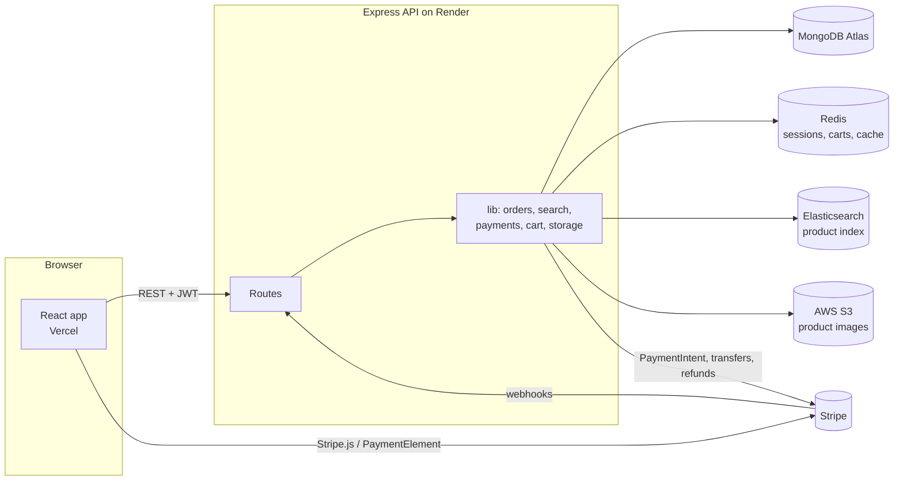
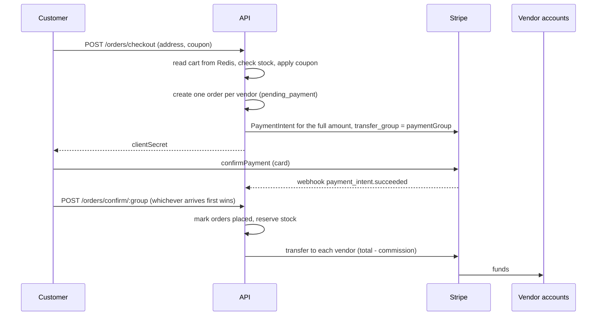
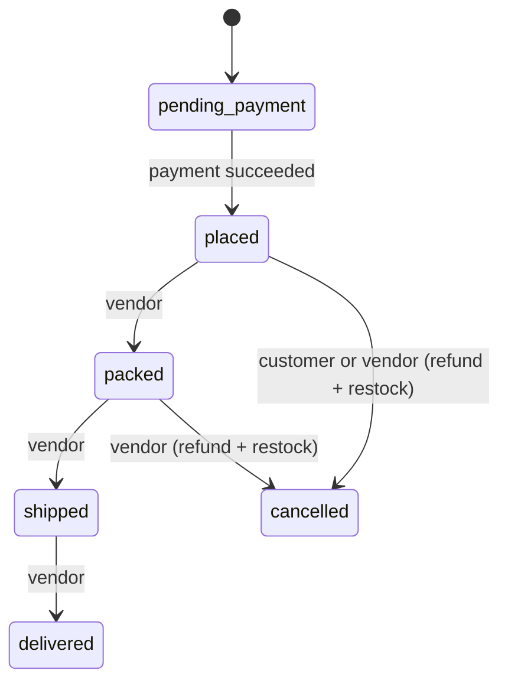
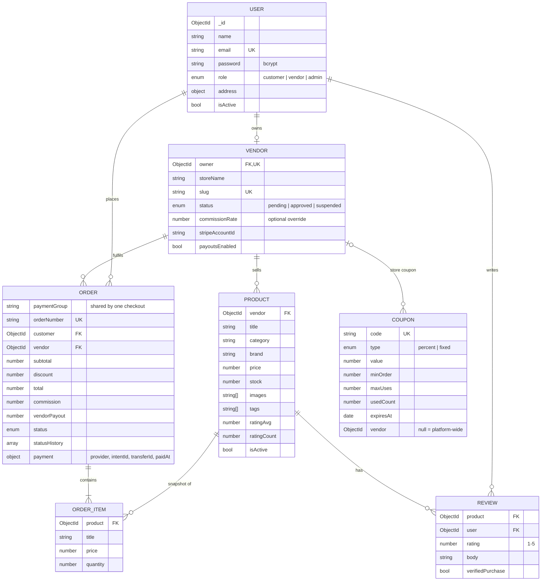

# Architecture

## Overview

- **MongoDB** is the source of truth for users, stores, products, orders, reviews and coupons.
- **Elasticsearch** holds a denormalised copy of each visible product (product data plus the store name). It is updated after every product write, review or store approval change. If ES is unreachable, writes still succeed and `POST /api/admin/search/reindex` rebuilds the index.
- **Redis** stores sessions (`session:<id>`), carts (`cart:<userId>`, a hash of productId to quantity) and cached product pages (`product:<id>`, 5 minute TTL, cleared on update).
- **S3** stores product images. The API uploads them and keeps the URLs on the product.

## Roles

| Role | Can do |
| --- | --- |
| customer | browse, search, cart, checkout, cancel own placed orders, review products, download own invoices |
| vendor | create a store, connect Stripe, manage own products, coupons and orders, move orders through the lifecycle |
| admin | approve or suspend stores, set per-store commission, manage platform coupons, disable users, view analytics, rebuild the search index |

Admins are only created by the seed script or directly in the database. Signing up as an admin through the API is rejected.

## Checkout and payment split

This is Stripe's "separate charges and transfers" model. The customer pays once, the platform holds the money, and each vendor's transfer is linked to the original charge with `source_transaction`. `completePayment` claims each order with an atomic `pending_payment → placed` update, so the webhook and the confirm call can both run without paying a vendor twice.

Commission is worked out per order: `commission = total × rate`, `vendorPayout = total − commission`. The rate is the vendor's own `commissionRate` if an admin set one, otherwise `COMMISSION_RATE` (10%).

A coupon's discount is split across vendor orders in proportion to their subtotals (only the matching vendor for store coupons), so each vendor's payout reflects the discount on their own items.

## Order lifecycle

Orders can only move one step forward. Every change is recorded in `statusHistory` with a timestamp.

## Database schema

Order items keep a copy of the title, image and price at the time of purchase, so invoices stay correct after a vendor edits or removes a product.

### Indexes

- `users.email` unique
- `vendors.owner`, `vendors.slug` unique
- `products.vendor`, `products.category`, plus a text index on title, description, brand and tags (used by the Mongo search fallback)
- `orders.paymentGroup`, `orders.customer`, `orders.vendor`, `orders.status`
- `reviews (product, user)` unique
- `coupons.code` unique

## Design decisions

- **One order per vendor.** Each vendor packs and ships independently, so splitting at checkout keeps the lifecycle, payouts and invoices simple. The shared `paymentGroup` ties them back to one payment.
- **Stock is taken when payment succeeds, not when the order is created.** Abandoned checkouts don't lock stock. If an item sold out between checkout and payment, that vendor's order is cancelled and refunded and the others go through.
- **Fallbacks for every external service.** The mock Redis, Mongo search and mock payment provider mean the project runs and is fully testable on a laptop with no accounts. Production config uses the real services.
- **Sessions in Redis on top of JWT.** A plain JWT can't be revoked. Checking a Redis session on each request costs about a millisecond and makes logout and account disabling take effect at once.
