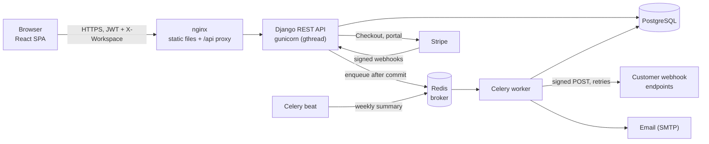
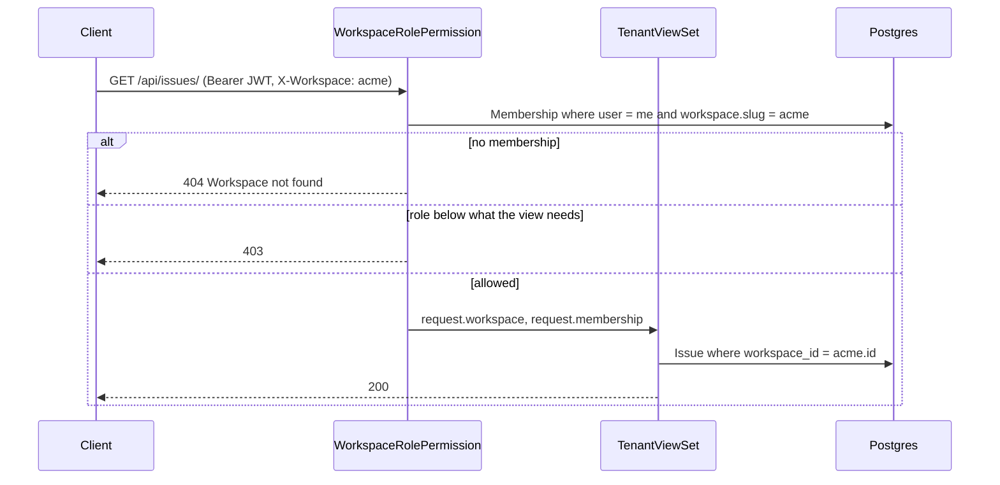
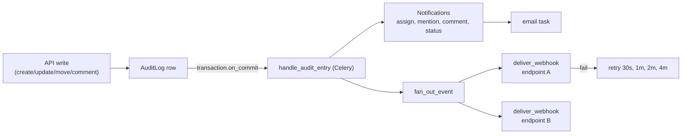
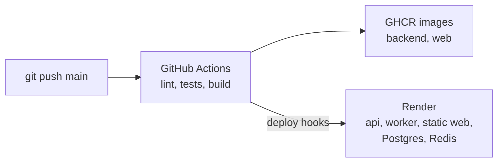

# Architecture

## System



| Component | Responsibility |
|---|---|
| React SPA | Board, backlog, issue drawer, settings, billing. TanStack Query for server state, dnd-kit for drag and drop |
| Django API | Auth, tenancy, permissions, business rules, audit log, Stripe integration |
| PostgreSQL | All tenant data in one schema |
| Redis + Celery | Notifications, webhook delivery, reports, weekly summaries |
| Stripe | Subscriptions. Our database mirrors the subscription state from Stripe webhooks |

## Tenant isolation

Shared database, shared schema, `workspace_id` on every tenant table. One deployment, one migration path, and
tenants can be onboarded with a single insert. The risk is a query that forgets the filter, so isolation is
enforced in a few central places and covered by tests:

1. `WorkspaceRolePermission` reads the `X-Workspace` header, loads the caller's `Membership` for that slug and
   stores `request.workspace`. If there is no membership the API returns **404**, so you can't probe which
   workspaces exist.
2. `TenantViewSet.get_queryset()` always applies `.for_workspace(request.workspace)`, and `perform_create` sets
   the workspace from the request. Clients never send it.
3. `WorkspaceRelatedField` / `MemberField` only accept ids from the current workspace, so a request can't attach
   another tenant's status, sprint, issue or user.
4. `Issue.clean()` checks that the status and sprint belong to the same project, as a second line of defence.
5. Attachments and report CSVs are streamed through the API instead of a public `/media` URL, so the same
   checks apply to downloads.
6. Webhooks and notifications are built from the audit entry's workspace, and endpoints are looked up by
   workspace.

`tests/test_tenancy_api.py` covers cross-tenant reads, writes and foreign-key smuggling.



## Data model

```mermaid
erDiagram
    USER ||--o{ MEMBERSHIP : has
    WORKSPACE ||--o{ MEMBERSHIP : has
    WORKSPACE ||--|| SUBSCRIPTION : billed_by
    WORKSPACE ||--o{ PROJECT : owns
    PROJECT ||--o{ STATUS : has
    PROJECT ||--o{ TRANSITION : allows
    PROJECT ||--o{ BOARD : has
    PROJECT ||--o{ SPRINT : plans
    PROJECT ||--o{ ISSUE : contains
    STATUS ||--o{ ISSUE : "column of"
    SPRINT |o--o{ ISSUE : "scheduled in"
    ISSUE ||--o{ COMMENT : has
    ISSUE ||--o{ ATTACHMENT : has
    WORKSPACE ||--o{ AUDIT_LOG : records
    WORKSPACE ||--o{ WEBHOOK_ENDPOINT : has
    WEBHOOK_ENDPOINT ||--o{ WEBHOOK_DELIVERY : logs
    USER ||--o{ NOTIFICATION : receives
    SPRINT ||--o{ REPORT : summarised_by

    MEMBERSHIP { string role "owner|admin|member|viewer" }
    WORKSPACE { string slug UK  string plan }
    PROJECT { string key "unique per workspace" int issue_counter }
    ISSUE { int number "unique per project" float rank string type string priority }
    SPRINT { string state "planned|active|closed" }
    TRANSITION { fk from_status fk to_status }
    AUDIT_LOG { string action json changes }
```

Key constraints, enforced in the database:

- `(workspace, key)` unique on projects, `(project, number)` unique on issues
- at most one `active` sprint per project (partial unique index)
- `(user, workspace)` unique on memberships
- an issue's status uses `RESTRICT`: a status with issues can't be deleted, but deleting a whole workspace
  cascades cleanly

## Key flows

**Issue numbers.** `Project.issue_counter` is incremented with `UPDATE ... SET issue_counter = issue_counter + 1`
inside the issue's transaction, so two concurrent creates never get the same `WEB-42`.

**Drag and drop.** Each card has a float `rank` within its column. A drop sends the ids of the new neighbours, and
the server stores the midpoint, so only the moved row is written. When two neighbours get closer than `1e-6`, the
column is renumbered in steps of 1024 before the move.

**Workflow rules.** A project with no transitions has an open workflow. Once any transition exists, only the listed
moves are allowed. Both `PATCH /issues/{id}` and `POST /issues/{id}/move/` check this. The board gets the transition
list and greys out columns you can't drop into.

**Events pipeline.**



Every write goes through the audit log, and one task turns each audit entry into notifications and webhook events,
so these features can't drift apart. Tasks are queued with `on_commit`, so a rolled-back request never sends a
webhook.

**Webhook delivery.** JSON body, `X-Sprintboard-Signature: sha256=HMAC(secret, body)`, 5-second timeout, no
redirects, 5 attempts with backoff, every attempt logged. URLs that resolve to private, loopback or link-local
addresses are rejected when the endpoint is saved and again at send time, to prevent SSRF.

**Billing.** Checkout and the customer portal are hosted by Stripe. Our database only changes when a signed Stripe
webhook arrives (`customer.subscription.*`, `checkout.session.completed`). Event ids are stored with a unique
constraint, so a redelivered event is processed once. Plan limits (projects, members, storage, webhooks) are
checked in the API and return `402` with `code: plan_limit`.

## Roles

| Action | viewer | member | admin | owner |
|---|:-:|:-:|:-:|:-:|
| Read projects, issues, boards | ✓ | ✓ | ✓ | ✓ |
| Create/edit issues, comment, upload | | ✓ | ✓ | ✓ |
| Delete issues | | | ✓ | ✓ |
| Projects, statuses, workflows | | | ✓ | ✓ |
| Invite members, change roles | | | ✓ | ✓ |
| Webhooks, workspace audit log | | | ✓ | ✓ |
| Grant or remove owner, billing changes | | | | ✓ |

## Deployment



Migrations run when the API container starts (`RUN_MIGRATIONS=1`). The worker runs beat with `-B`, so a single
instance covers both.
